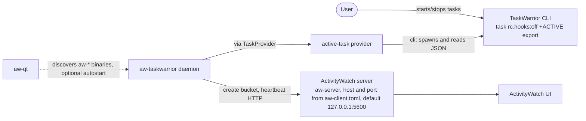
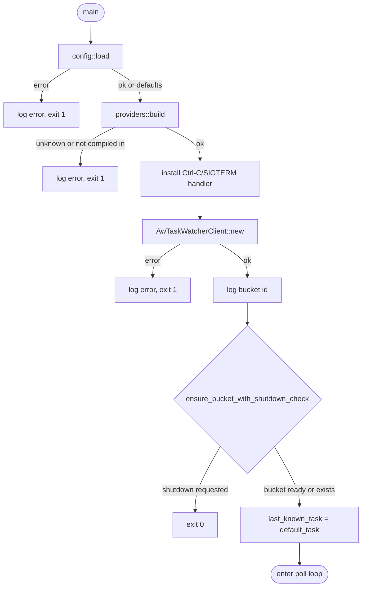
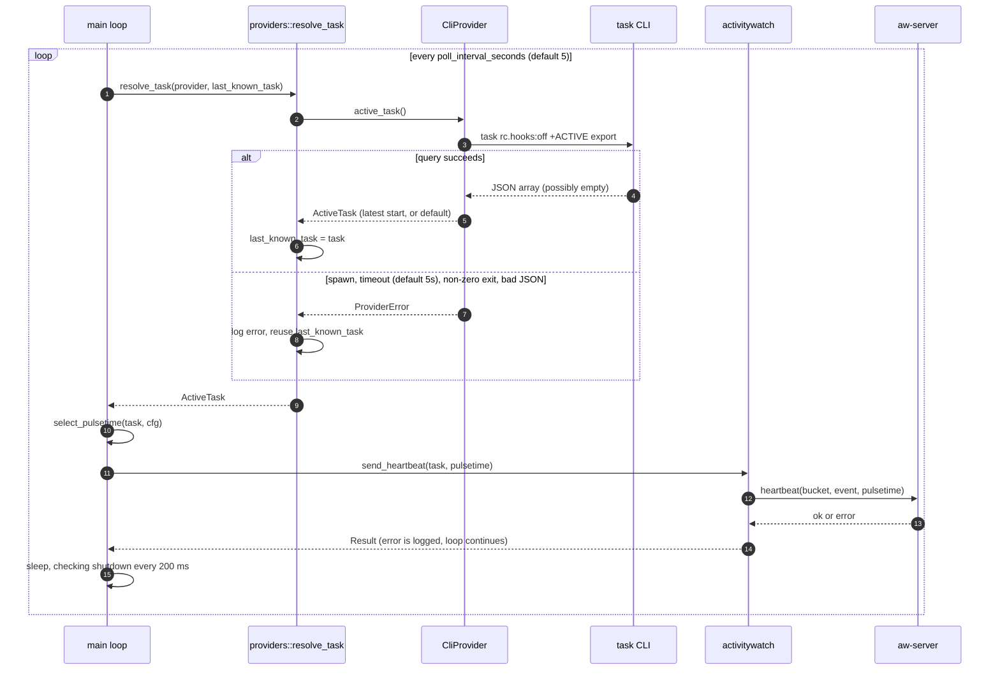
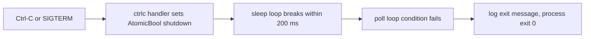

# Architecture

aw-taskwarrior is a single-process polling daemon. Every few seconds it asks TaskWarrior which task is active, then sends one heartbeat to an ActivityWatch server. ActivityWatch merges heartbeats into time spans.

## System context

External parts:
- **TaskWarrior CLI (`task`)**: source of the active-task state for the `cli` provider. Run with hooks disabled.
- **ActivityWatch server (`aw-server`)**: receives the bucket and heartbeats over HTTP.
- **aw-qt**: optional. It starts the daemon when listed in its `autostart_modules`.

### Provider seam (REQ-006)

The watcher never calls `task` itself. It holds a `Box<dyn TaskProvider>` built from config (`provider = "cli"` by default; `provider = "http"` reads from the task-rest API). Each provider crate is selected by a Cargo feature, and both are on by default. The library provider (REQ-008) will plug into the same seam and is not implemented yet.

The HTTP provider logs in to `GET /auth` with Basic credentials from config when they are set, then reads the active tasks with `GET /?status=pending&start.any=` and the token. Without credentials (task-rest local mode, REQ-012) it reads the same filtered list with no login. See [REQ-007](requirements/REQ-007-http-task-provider.md), [REQ-010](requirements/REQ-010-task-rest-attribute-filter.md) and [REQ-012](requirements/REQ-012-http-provider-optional-auth.md).

## Startup

The provider is built before any network I/O, so a bad `provider` value fails immediately.

`ensure_bucket_with_shutdown_check` retries forever. Each failed attempt logs an error and waits 30 seconds, checking the shutdown flag once per second.

## Poll loop

Key rules:
- The active task is the one with the most recent `start` timestamp. Tasks with an unparseable `start` sort last.
- With no active task, the heartbeat carries the title `No task tracked`.
- Pulsetime depends on the task's tags. A task with the offline tag gets the long pulsetime (12 h by default), so a suspend does not split its span. Other tasks get 120 s.
- Empty values are omitted from the heartbeat data: project, tags and uuid are left out when empty or absent.

## Shutdown

Shutdown is also honored during startup retries and during the sleep between polls. An in-flight heartbeat or `task` query is not interrupted.

## Failure handling

| Failure | Behavior |
|---------|----------|
| Provider error (for `cli`: `task` missing, timed out, non-zero exit, or invalid JSON) | Log error, reuse last known task |
| Unknown or not compiled-in provider name | Fatal at startup, exit 1 |
| Invalid provider settings (e.g. `timeout_seconds = 0`) | Fatal at startup, exit 1 |
| ActivityWatch unreachable at startup | Log error, retry every 30 s until reachable or shutdown |
| Heartbeat fails | Log error, next poll sends again |
| `aw-client.toml` or `aw-taskwarrior.toml` unreadable or malformed, or an unknown key in `[aw-taskwarrior]` | Fatal, exit 1; the message names the file |
| Either config file missing | Use built-in defaults |

## Design decisions

- **Polling, not hooks.** One long-running daemon replaces per-event processes spawned by TaskWarrior hooks. (Source: README.)
- **Server-side gap merging.** Dynamic pulsetime replaces the client-side AFK-based backfill.
- **Graceful degradation.** A failed `task` query reuses the last known state. An unreachable server is retried indefinitely.
- **stdout/stderr logging only.** No log files, so aw-qt can read the output.
- **Zero-config default.** Every setting has a built-in default in `crates/aw-taskwarrior/src/config.rs`.
- **ActivityWatch config convention.** Settings live in `~/.config/activitywatch/aw-taskwarrior/aw-taskwarrior.toml`. The server host and port are read from `aw-client.toml`, so there is one source of truth for the server (REQ-009).
- **Plugin-style providers.** The watcher depends only on the `TaskProvider` trait. Each source is a separate crate, selected by config and a Cargo feature (REQ-006).

## Known issue

`CliProvider::query` (in `crates/aw-taskwarrior-provider-cli/src/lib.rs`) spawns `task` once to wait for it to exit, then runs it a second time with `.output()` to collect stdout. The first run's output is discarded. Each poll therefore starts TaskWarrior twice. Tracked in [STATUS.md](STATUS.md).
