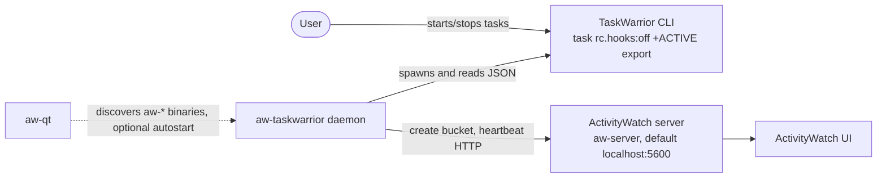
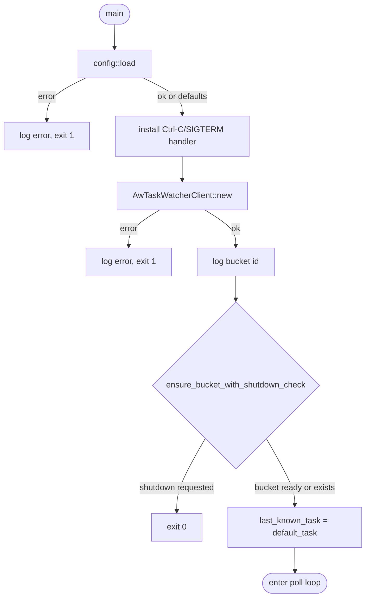
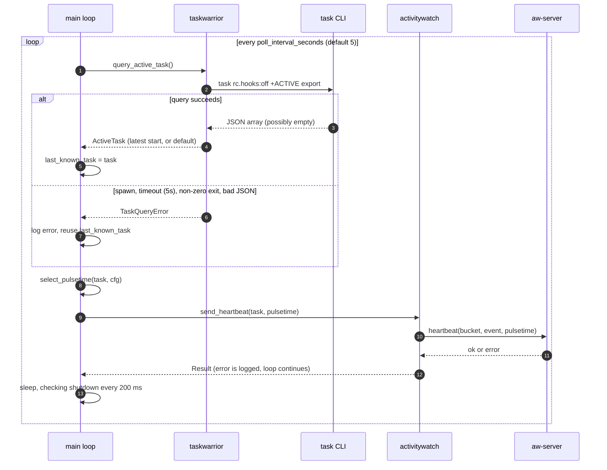
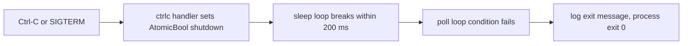

# Architecture

aw-taskwarrior is a single-process polling daemon. Every few seconds it asks TaskWarrior which task is active, then sends one heartbeat to an ActivityWatch server. ActivityWatch merges heartbeats into time spans.

## System context

External parts:
- **TaskWarrior CLI (`task`)**: source of the active-task state. Run with hooks disabled.
- **ActivityWatch server (`aw-server`)**: receives the bucket and heartbeats over HTTP.
- **aw-qt**: optional. It starts the daemon when listed in its `autostart_modules`.

### Planned: provider seam (REQ-006)

The watcher will stop calling `task` directly. It will call a `TaskProvider` chosen from config, and the CLI, HTTP (REQ-007) and library (REQ-008) providers will sit behind it. This section describes the current code; it will be updated when REQ-006 lands.

## Startup

`ensure_bucket_with_shutdown_check` retries forever. Each failed attempt logs an error and waits 30 seconds, checking the shutdown flag once per second.

## Poll loop

Key rules:
- The active task is the one with the most recent `start` timestamp. Tasks with an unparseable `start` sort last.
- With no active task, the heartbeat carries the title `No task tracked`.
- Pulsetime depends on the task's tags. A task with the offline tag gets the long pulsetime (12 h by default), so a suspend does not split its span. Other tasks get 120 s.
- Empty values are omitted from the heartbeat data: project, tags and uuid are left out when empty or absent.

## Shutdown

Shutdown is also honored during startup retries and during the sleep between polls. An in-flight heartbeat or `task` query is not interrupted.

## Failure handling

| Failure | Behavior |
|---------|----------|
| `task` missing, timed out, non-zero exit, or invalid JSON | Log error, reuse last known task |
| ActivityWatch unreachable at startup | Log error, retry every 30 s until reachable or shutdown |
| Heartbeat fails | Log error, next poll sends again |
| Config file unreadable or malformed | Fatal, exit 1 |
| Config file missing | Use built-in defaults |

## Design decisions

- **Polling, not hooks.** One long-running daemon replaces per-event processes spawned by TaskWarrior hooks. (Source: README.)
- **Server-side gap merging.** Dynamic pulsetime replaces the client-side AFK-based backfill.
- **Graceful degradation.** A failed `task` query reuses the last known state. An unreachable server is retried indefinitely.
- **stdout/stderr logging only.** No log files, so aw-qt can read the output.
- **Zero-config default.** Every setting has a built-in default in `src/config.rs`.

## Known issue

`taskwarrior::query_active_task` spawns `task` once to wait for it to exit, then runs it a second time with `.output()` to collect stdout. The first run's output is discarded. Each poll therefore starts TaskWarrior twice. Tracked in [STATUS.md](STATUS.md).
