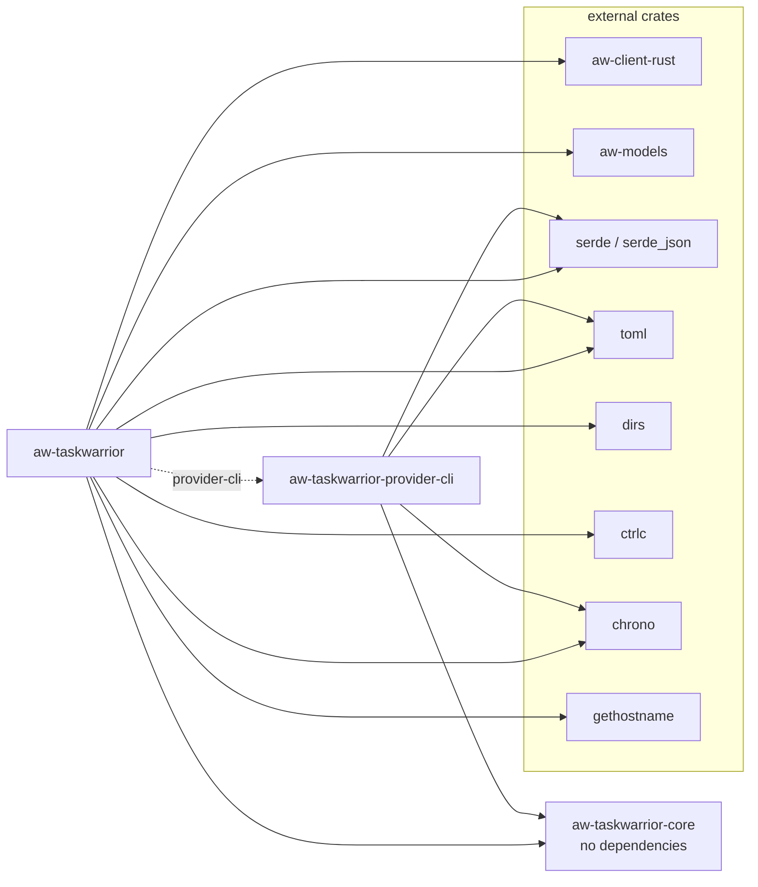

# Dependencies

The workspace declares shared versions in the root `Cargo.toml` under `[workspace.dependencies]`. Each crate refers to them with `workspace = true`.

## Crate dependencies by crate

| Crate | Dependency | Version / source | Purpose | Used by |
|-------|------------|------------------|---------|---------|
| aw-taskwarrior-core | (none) | | Zero dependencies by design | |
| aw-taskwarrior-provider-cli | aw-taskwarrior-core | path | `ActiveTask`, `TaskProvider`, `ProviderError` | `lib.rs` |
| aw-taskwarrior-provider-cli | chrono | 0.4 (serde) | Parse TaskWarrior timestamps | `lib.rs` |
| aw-taskwarrior-provider-cli | serde | 1 (derive) | Derive for the `task` export JSON struct | `lib.rs` |
| aw-taskwarrior-provider-cli | serde_json | 1 | Parse `task` export output | `lib.rs` |
| aw-taskwarrior-provider-cli | toml | 0.8 | `toml::Table` settings for `create()` | `lib.rs` |
| aw-taskwarrior (watcher) | aw-taskwarrior-core | path | Shared model and trait | `activitywatch.rs`, `main.rs`, `providers.rs` |
| aw-taskwarrior (watcher) | aw-taskwarrior-provider-cli | path, optional (feature `provider-cli`) | CLI provider | `providers.rs` |
| aw-taskwarrior (watcher) | aw-client-rust | git `ActivityWatch/aw-server-rust` rev `2875df5` | ActivityWatch HTTP client (blocking) | `activitywatch.rs` |
| aw-taskwarrior (watcher) | aw-models | git `ActivityWatch/aw-server-rust` rev `2875df5` | `Event` model | `activitywatch.rs` |
| aw-taskwarrior (watcher) | serde | 1 (derive) | Config struct derives | `config.rs` |
| aw-taskwarrior (watcher) | serde_json | 1 | Heartbeat data | `activitywatch.rs` |
| aw-taskwarrior (watcher) | toml | 0.8 | Config file parsing, provider settings table | `config.rs` |
| aw-taskwarrior (watcher) | dirs | 5 | Locate the config directory | `config.rs` |
| aw-taskwarrior (watcher) | ctrlc | 3 | Ctrl-C and SIGTERM handler | `main.rs` |
| aw-taskwarrior (watcher) | chrono | 0.4 (serde) | Timestamps | `activitywatch.rs`, `log.rs` |
| aw-taskwarrior (watcher) | gethostname | 0.4 | Hostname for the bucket id | `activitywatch.rs` |

Release profile (root `Cargo.toml`, applies to the whole workspace): `opt-level = 3`, `lto = true`, `codegen-units = 1`.

The git dependencies are pinned to one commit. Updating `rev` changes the ActivityWatch API surface and needs a code check.

## Feature flags

| Crate | Feature | Default | Enables |
|-------|---------|---------|---------|
| aw-taskwarrior | `provider-cli` | yes | `aw-taskwarrior-provider-cli`; selectable as `provider = "cli"` |
| aw-taskwarrior | `provider-http` | planned (REQ-007) | `aw-taskwarrior-provider-http` |
| aw-taskwarrior | `provider-lib` | planned (REQ-008) | `aw-taskwarrior-provider-lib` |

Build without providers (for testing the plumbing): `cargo check -p aw-taskwarrior --no-default-features`. The binary then fails at startup with the "not available" message for any provider name.

## Dependency graph

## Runtime dependencies

| Dependency | Required | Used for | Failure behavior |
|------------|----------|----------|------------------|
| `task` (TaskWarrior CLI) on `PATH` | Yes, when provider is `cli` | Active-task query, every poll | Logged; last known task is reused |
| `aw-server` on `aw_server_host:aw_server_port` | Yes (retried) | Bucket creation, heartbeats | Startup retries every 30 s; heartbeat errors are logged |
| Config file `~/.config/aw-taskwarrior/config.toml` | No | Overrides defaults, selects provider | Missing: defaults. Malformed: fatal. |
| aw-qt | No | Optional discovery and autostart | None |
