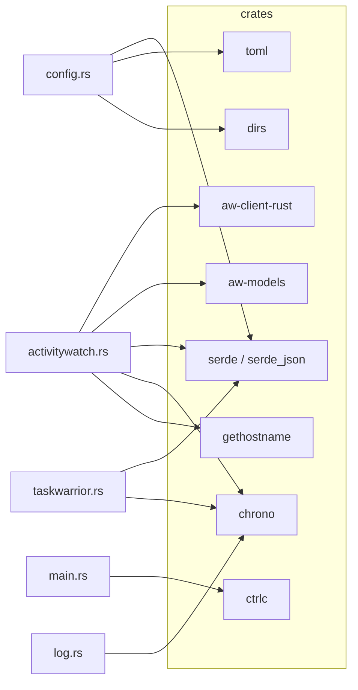

# Dependencies

## Crate dependencies

Declared in `Cargo.toml`.

| Crate | Version / source | Purpose | Used by |
|-------|------------------|---------|---------|
| `aw-client-rust` | git `ActivityWatch/aw-server-rust` rev `2875df5` | ActivityWatch HTTP client (blocking) | `activitywatch.rs` |
| `aw-models` | git `ActivityWatch/aw-server-rust` rev `2875df5` | `Event` model | `activitywatch.rs` |
| `serde` | 1 (derive) | Derive for JSON and TOML structs | `config.rs`, `taskwarrior.rs` |
| `serde_json` | 1 | Parse `task` export, build heartbeat data | `taskwarrior.rs`, `activitywatch.rs` |
| `toml` | 0.8 | Parse config file | `config.rs` |
| `dirs` | 5 | Locate the config directory | `config.rs` |
| `ctrlc` | 3 | Ctrl-C and SIGTERM handler | `main.rs` |
| `chrono` | 0.4 (serde) | Timestamps, timestamp parsing, log times | `taskwarrior.rs`, `activitywatch.rs`, `log.rs` |
| `gethostname` | 0.4 | Hostname for the bucket id | `activitywatch.rs` |

Release profile: `opt-level = 3`, `lto = true`, `codegen-units = 1`.

The git dependencies are pinned to one commit. Updating `rev` changes the ActivityWatch API surface and needs a code check.

## Runtime dependencies

| Dependency | Required | Used for | Failure behavior |
|------------|----------|----------|------------------|
| `task` (TaskWarrior CLI) on `PATH` | Yes | Active-task query, every poll | Logged; last known task is reused |
| `aw-server` on `aw_server_host:aw_server_port` | Yes (retried) | Bucket creation, heartbeats | Startup retries every 30 s; heartbeat errors are logged |
| Config file `~/.config/aw-taskwarrior/config.toml` | No | Overrides defaults | Missing: defaults. Malformed: fatal. |
| aw-qt | No | Optional discovery and autostart | None |
