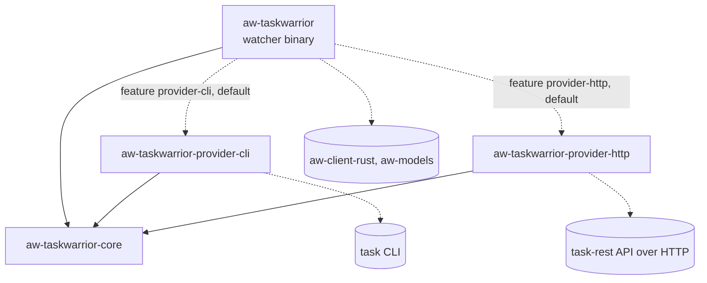
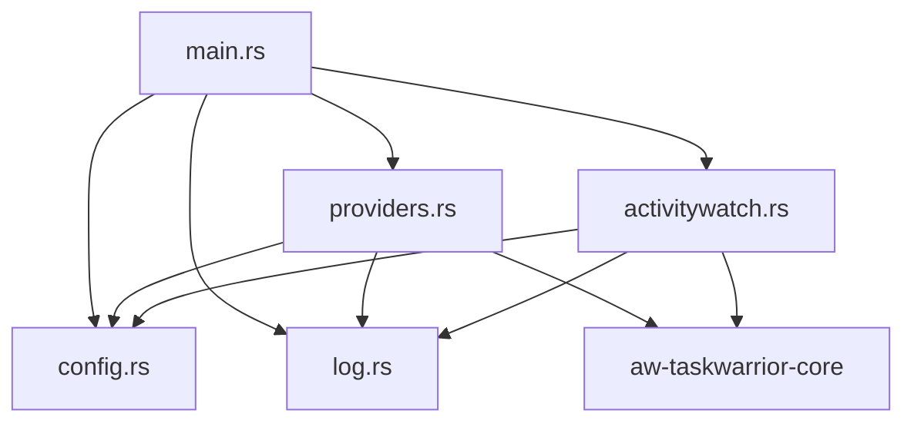

# Modules

The repository is a Cargo workspace (`crates/*`) with four crates. The watcher binary (`aw-taskwarrior`) contains five modules. The provider crate and the core crate hold the task-source logic and the shared interface.

## Crate dependency graph

`aw-taskwarrior-core` has no dependencies. The watcher never imports provider internals; it reaches a provider only through `providers.rs` and the `TaskProvider` trait.

## Watcher module graph

`config` and `log` do not depend on other project modules.

---

## aw-taskwarrior-core (`crates/aw-taskwarrior-core/src/lib.rs`)

**Responsibility:** the shared model and the interface every provider implements. Zero dependencies.

| Item | Kind | Notes |
|------|------|-------|
| `ActiveTask` | struct | `uuid: Option<String>`, `title`, `project`, `tags`. The task currently being tracked. |
| `ActiveTask::default_task()` | fn | Title "No task tracked", no uuid, empty project and tags |
| `TaskProvider` | trait (`Send`) | `name(&self) -> &'static str`; `active_task(&self) -> Result<ActiveTask, ProviderError>` |
| `ProviderError` | enum | `Unavailable(String)`, `Timeout`, `InvalidResponse(String)`, `InvalidConfig(String)`. Implements `Display` and `Error`. |

- Tests: none (behavior is covered by the watcher and provider tests).

## aw-taskwarrior-provider-cli (`crates/aw-taskwarrior-provider-cli/src/lib.rs`)

**Responsibility:** the CLI provider. Runs `task rc.hooks:off +ACTIVE export` and turns its JSON into one `ActiveTask`.

| Item | Kind | Notes |
|------|------|-------|
| `NAME` | const | `"cli"`. Used in config (`provider = "cli"`) and logs. |
| `create(settings: Option<&toml::Table>)` | fn | Builds the provider from `[aw-taskwarrior.providers.cli]`. Key `timeout_seconds`: positive integer, default 5. Any other value gives `InvalidConfig`. |
| `CliProvider` | struct | Holds the timeout. `new(Duration)`. Implements `TaskProvider`. |
| `CliProvider::active_task` (via trait) | fn | Maps `TaskQueryError` to `ProviderError`: `Timeout` to `Timeout`, `InvalidJson` to `InvalidResponse`, `Spawn` and `NonZeroExit` to `Unavailable` |
| `RawTwTask` | struct | JSON shape: `uuid`, `description`, `project`, `tags`, `start` (`YYYYMMDDTHHMMSSZ`) |
| `TaskQueryError` | enum | `Spawn`, `Timeout`, `NonZeroExit`, `InvalidJson`. Internal to the crate. |
| `CliProvider::query()` | fn (private) | Empty output or empty array gives the default task. Otherwise picks the latest task. |
| `run_task_export_with_timeout()` | fn (private) | Spawns `task`, polls for exit every 50 ms, kills it on timeout. See the known issue in [architecture.md](architecture.md). |
| `pick_latest()` | fn (private) | Sorts by parsed `start`, newest first |
| `parse_tw_timestamp()` | fn (private) | Parses the TaskWarrior timestamp format. Invalid values give `None`. |

- Tests (11): empty array, single task, missing project, most recent start wins, unparseable start sorts last, timestamp format, invalid timestamp, and `create` with no settings, a valid timeout, a non-positive timeout, and a non-integer timeout.

## aw-taskwarrior-provider-http (`crates/aw-taskwarrior-provider-http/src/lib.rs`)

**Responsibility:** the HTTP provider for task-rest (REQ-007). Authenticates with `GET /auth` (Basic), lists tasks with `GET /` (`x-access-tokens`), and picks the active task on the client side.

| Item | Kind | Notes |
|------|------|-------|
| `NAME` | const | `"http"`. Used in config (`provider = "http"`) and logs. |
| `create(settings: Option<&toml::Table>)` | fn | Builds the provider from `[aw-taskwarrior.providers.http]`. Keys: `base_url` (required; http or https; no user info, query or fragment; a path prefix is kept), `username` and `password` (required, non-empty), `timeout_seconds` (positive integer, default 5). Any invalid value gives `InvalidConfig` naming the key. No network I/O. |
| `HttpProvider` | struct | Holds the blocking client, the base URL, the credentials and the cached JWT (`Mutex<Option<String>>`). Its `Debug` output hides the password and token. |
| `HttpProvider::active_task` (via trait) | fn | Uses the cached token or authenticates. On `401`, re-authenticates once and retries. Second `401` gives `Unavailable("authentication rejected: ...")`. |
| `select_active()` | fn (private) | Keeps tasks with `status == "pending"` and a `start`. Picks the latest start; ties go to the higher `id`; unparseable starts sort last. No match gives `ActiveTask::default_task()`. |
| `read_active_task()` | fn (private) | Maps a response: `401` to auth rejected; a `message` object with `type == "error"` to `Unavailable(description)`; other non-2xx to `Unavailable("HTTP <code>")`; non-JSON on 2xx or a missing `tasks` list to `InvalidResponse`. |
| `ApiTask` | struct (private) | One task from task-rest: `id`, `description`, `status`, `start` (RFC 2822 text), `project`, `tags`, `uuid`. Missing optional fields default. |
| `live_task_rest_returns_active_task` | test (ignored) | Needs a running task-rest and `TASK_REST_URL`, `TASK_REST_USER`, `TASK_REST_PASSWORD`. Run with `cargo test -p aw-taskwarrior-provider-http -- --ignored --nocapture`. |

- Tests (28, plus the ignored live test): settings validation (required keys, scheme, user info, query, empty values, timeout, path prefix, Debug hides secrets); RFC 2822 offsets resolve to the same instant; selection on the captured fixture (`tests/fixtures/task_list.json`, real task-rest responses): latest start with id tie-break, active set, project and tags mapping, pending without start, completed or deleted tasks, empty list, unparseable start; HTTP flow against a loopback mock server: auth then list with the token header, cached token reuse, expired token replaced and retried, second rejection with no secrets in the error, wrong password, error message bodies, non-JSON bodies, `500` without JSON, connection refused, timeout.
- The mock server binds only to `127.0.0.1` on port 0. The test suite makes no other network calls.

---

## aw-taskwarrior (watcher) (`crates/aw-taskwarrior/src/main.rs`)

### main.rs

**Responsibility:** entry point. Loads config, builds the provider, installs the shutdown handler, creates the ActivityWatch client, and runs the poll loop.

- Private functions: `main`, `sleep_with_shutdown_check(Duration, &Arc<AtomicBool>)`.
- Uses: `config::load`, `providers::build`, `providers::resolve_task`, `activitywatch::AwTaskWatcherClient`, `activitywatch::select_pulsetime`, `ActiveTask::default_task`, `log::*`.
- Startup order: config, provider (fails fast, before any network I/O), signal handler, ActivityWatch client, bucket.
- Tests: none.

### config.rs

**Responsibility:** runtime settings with defaults, following the ActivityWatch config convention (REQ-009). Server host and port come from `~/.config/activitywatch/aw-client/aw-client.toml`; daemon settings come from `~/.config/activitywatch/aw-taskwarrior/aw-taskwarrior.toml`, section `[aw-taskwarrior]`. Both files are optional. Base directory via `dirs::config_dir`.

| Item | Kind | Notes |
|------|------|-------|
| `Config` | struct | Fields: `poll_interval_seconds` (5), `aw_server_host` ("127.0.0.1", from aw-client.toml), `aw_server_port` (5600, from aw-client.toml), `api_key` (None), `offline_tag` ("OFFLINE"), `online_pulsetime_seconds` (120), `offline_pulsetime_seconds` (43200), `provider` ("cli"), `providers` (empty table) |
| `ConfigLoadError` | enum | `Io { path, source }`, `Parse { path, source }`, `InvalidValue { path, message }`. All are fatal at startup and name the file. |
| `config_path()` | fn | Path of `aw-taskwarrior.toml`, or None if no config dir exists |
| `client_config_path()` | fn | Path of `aw-client.toml`, or None if no config dir exists |
| `load(testing: bool)` | fn | Reads `aw-client.toml` (`[server]`, or `[server-testing]` when testing; port may be a string or an integer), then `aw-taskwarrior.toml` (`[aw-taskwarrior]`, or `[aw-taskwarrior-testing]`). Missing files give defaults. Testing mode defaults the port to 5666. Always called with `false` until REQ-001. |

- Private types: `ClientFile`/`ServerSection`/`PortValue` (aw-client.toml), `OwnFile`/`Section` (aw-taskwarrior.toml). `Section` rejects unknown keys, so a removed `aw_server_host` or `aw_server_port` fails at startup.
- Private functions: `load_from(client_path, own_path, testing)` (testable core of `load`), `read_optional`, `apply_client_file`, `apply_own_file`, `component_path`.
- The old path `~/.config/aw-taskwarrior/config.toml` is never read.

- `providers` holds the raw `[aw-taskwarrior.providers.<name>]` tables. The watcher does not interpret them; they are passed to the chosen provider's `create()`.
- Tests (22): defaults and provider default; config paths follow the convention; aw-client.toml with string port, integer port, missing keys, testing section, ignored sections, non-numeric port, malformed file; aw-taskwarrior.toml full section, partial section, nested provider settings, removed server key rejected and named, testing section, ignored sections, wrong type; `load_from` with no files, missing files, testing defaults, both files, malformed file names its path.

### providers.rs

**Responsibility:** the only watcher file that knows which providers exist. Selects the provider from config and applies the watcher's failure policy.

| Item | Kind | Notes |
|------|------|-------|
| `build(&Config)` | fn | Matches `cfg.provider`. Each provider is one `cfg(feature)` arm. An unknown or not-compiled name gives `Err("provider '<name>' is not available; rebuild with the matching feature")`. |
| `resolve_task(&dyn TaskProvider, &mut ActiveTask)` | fn | On success, updates `last_known` and returns the task. On error, logs it and returns `last_known`. |

- `build()` also has an `http` arm (feature `provider-http`) that passes `[aw-taskwarrior.providers.http]` to `aw_taskwarrior_provider_http::create`.
- Tests (6): success updates last known, failure returns last known, failure before any success returns the default, unknown provider is an error, `http` without settings names `base_url`, default provider builds `cli`.

### activitywatch.rs

**Responsibility:** ActivityWatch client wrapper: bucket creation, heartbeat construction, and pulsetime choice.

| Item | Kind | Notes |
|------|------|-------|
| `AwTaskWatcherClient` | struct | Holds `AwClient` and the bucket id |
| `new(&Config)` | fn | Bucket id is `aw-watcher-taskwarrior_{hostname}`. Client name "aw-taskwarrior". |
| `bucket_id()` | fn | Returns the bucket id |
| `ensure_bucket_with_shutdown_check(&Arc<AtomicBool>)` | fn | Creates bucket type `task-activity`. Treats "304" or "already exists" as success. Retries every 30 s. |
| `send_heartbeat(&ActiveTask, f64)` | fn | Builds event data with only non-empty fields: `title`, `project`, `tags`, `uuid`. Duration is zero. |
| `select_pulsetime(&ActiveTask, &Config)` | fn | Offline pulsetime if any tag equals `offline_tag`, otherwise online pulsetime |

- Tests (3): offline tag present, absent, custom tag name.

### log.rs

**Responsibility:** timestamped logging to stdout (info) and stderr (error). No levels beyond these two, no files.

| Item | Kind | Notes |
|------|------|-------|
| `log_info(&str)` | fn | `[RFC3339 timestamp] INFO  msg` on stdout |
| `log_error(&str)` | fn | `[RFC3339 timestamp] ERROR msg` on stderr |

- Tests: none.

---

## Test summary

70 unit tests, all run with `cargo test` from the repository root, plus 1 live test that is ignored by default:

| Crate | Tests |
|-------|-------|
| aw-taskwarrior-core | 0 |
| aw-taskwarrior-provider-cli | 11 |
| aw-taskwarrior-provider-http | 28 (+1 ignored live test) |
| aw-taskwarrior (watcher) | 31 (config 22, activitywatch 3, providers 6) |
