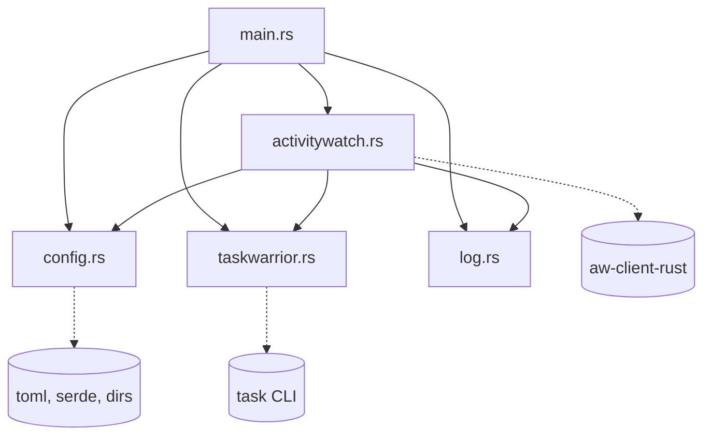

# Modules

The crate is a binary (`src/main.rs`) with four private modules and one logging helper.

## Module dependency graph

`config`, `taskwarrior` and `log` do not depend on other project modules.

## main.rs

**Responsibility:** entry point. Loads config, installs the shutdown handler, creates the ActivityWatch client, and runs the poll loop.

- Private functions: `main`, `sleep_with_shutdown_check(Duration, &Arc<AtomicBool>)`.
- Uses: `config::load`, `activitywatch::AwTaskWatcherClient`, `activitywatch::select_pulsetime`, `taskwarrior::query_active_task`, `taskwarrior::ActiveTask::default_task`, `log::*`.
- Tests: none.

## config.rs

**Responsibility:** runtime settings with defaults, overlaid by an optional TOML file at `~/.config/aw-taskwarrior/config.toml` (via `dirs::config_dir`).

| Item | Kind | Notes |
|------|------|-------|
| `Config` | struct | Fields: `poll_interval_seconds` (5), `aw_server_host` ("localhost"), `aw_server_port` (5600), `api_key` (None), `offline_tag` ("OFFLINE"), `online_pulsetime_seconds` (120), `offline_pulsetime_seconds` (43200) |
| `ConfigLoadError` | enum | `Io`, `Parse`. Both are fatal at startup. |
| `config_path()` | fn | Returns the config file path, or None if no config dir exists |
| `load()` | fn | Missing file returns defaults. Present file overlays only the keys it sets. |

- Tests (4): defaults, partial overlay, full overlay, malformed TOML is a parse error.

## taskwarrior.rs

**Responsibility:** run `task rc.hooks:off +ACTIVE export` and turn its JSON into one `ActiveTask`.

| Item | Kind | Notes |
|------|------|-------|
| `RawTwTask` | struct | JSON shape: `uuid`, `description`, `project`, `tags`, `start` (`YYYYMMDDTHHMMSSZ`) |
| `ActiveTask` | struct | Chosen task: `uuid`, `title`, `project`, `tags`. Missing project becomes "No project". |
| `ActiveTask::default_task()` | fn | Title "No task tracked", no uuid, empty project and tags |
| `TaskQueryError` | enum | `Spawn`, `Timeout` (5 s), `NonZeroExit`, `InvalidJson` |
| `query_active_task()` | fn | Public entry point. Empty output or empty array gives the default task. |
| `run_task_export_with_timeout()` | fn (private) | Spawns `task`, polls for exit every 50 ms, kills it on timeout. See the known issue in [architecture.md](architecture.md). |
| `pick_latest()` | fn (private) | Sorts by parsed `start`, newest first |
| `parse_tw_timestamp()` | fn (private) | Parses the TaskWarrior timestamp format. Invalid values give `None`. |

- Tests (7): empty array, single task, missing project, most recent start wins, unparseable start sorts last, timestamp format, invalid timestamp.

## activitywatch.rs

**Responsibility:** ActivityWatch client wrapper: bucket creation, heartbeat construction, and pulsetime choice.

| Item | Kind | Notes |
|------|------|-------|
| `AwTaskWatcherClient` | struct | Holds `AwClient` and the bucket id |
| `new(&Config)` | fn | Bucket id is `aw-watcher-taskwarrior_{hostname}`. Client name "aw-taskwarrior". |
| `bucket_id()` | fn | Returns the bucket id |
| `ensure_bucket_with_shutdown_check(&Arc<AtomicBool>)` | fn | Creates bucket type `task-activity`. Treats "304" or "already exists" as success. Retries every 30 s. |
| `send_heartbeat(&ActiveTask, f64)` | fn | Builds event data with only non-empty fields: `title`, `project`, `tags`, `uuid`. Duration is zero. |
| `select_pulsetime(&ActiveTask, &Config)` | fn | Offline pulsetime if any tag equals `offline_tag`, otherwise online pulsetime |

- Tests (3): offline tag present, absent, custom tag name.

## log.rs

**Responsibility:** timestamped logging to stdout (info) and stderr (error). No levels beyond these two, no files.

| Item | Kind | Notes |
|------|------|-------|
| `log_info(&str)` | fn | `[RFC3339 timestamp] INFO  msg` on stdout |
| `log_error(&str)` | fn | `[RFC3339 timestamp] ERROR msg` on stderr |

- Tests: none.

## Test summary

14 unit tests, all run with `cargo test`: config 4, taskwarrior 7, activitywatch 3.
