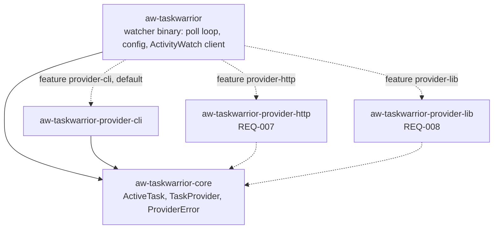

# REQ-006: Plugin-style active-task providers as Cargo workspace crates

- **Status:** Documented, not implemented
- **Added:** 2026-11-05
- **Owner:** maintainer

## Rationale

The watcher currently calls the `task` CLI directly. It should only ask "what is the active task?" and not know where the answer comes from. Future sources (an HTTP REST API, an in-process library) must plug in without changing the poll loop.

## Design

Three layers, as Cargo workspace members under `crates/`:



- **`aw-taskwarrior-core`**: zero dependencies. Defines `ActiveTask`, the trait `TaskProvider`, and `ProviderError`.
- **`aw-taskwarrior-provider-<name>`**: one crate per provider. Implements `TaskProvider` and exposes `pub const NAME` and `pub fn create(settings: Option<&toml::Table>) -> Result<Box<dyn TaskProvider>, ProviderError>`.
- **`aw-taskwarrior`** (watcher): depends on core and on each enabled provider crate through a Cargo feature. Its `providers::build(&Config)` selects the provider by name.

Trait:

```rust
pub trait TaskProvider: Send {
    fn name(&self) -> &'static str;
    fn active_task(&self) -> Result<ActiveTask, ProviderError>;
}

pub enum ProviderError {
    Unavailable(String),     // source cannot be reached or failed to run
    Timeout,                 // source did not answer in time
    InvalidResponse(String), // source answered with data that cannot be parsed
    InvalidConfig(String),   // provider settings are invalid
}
```

Configuration (watcher config file, backward compatible; no file means `cli`):

```toml
provider = "cli"            # which compiled-in provider to use

[providers.cli]             # opaque to the watcher; passed to the provider's create()
timeout_seconds = 5
```

- Selecting a provider that is not compiled in is a fatal startup error with the message: `provider '<name>' is not available; rebuild with the matching feature`.
- The watcher's policy is unchanged: on a provider error, log it and reuse the last known task. This is `resolve_task` in `providers.rs`.

Adding a provider: new crate, new feature, one `cfg` arm in `providers.rs`, and a requirement in `docs/requirements/` first.

## Acceptance criteria

- [ ] `aw-taskwarrior-core` has no dependencies.
- [ ] The watcher does not import any provider internals; it only uses `providers::build`, `TaskProvider`, and `ActiveTask`.
- [ ] The CLI provider is an `aw-taskwarrior-provider-cli` crate with the existing behavior and its 7 unit tests.
- [ ] With no config file, the daemon behaves as before (same bucket id, same heartbeats, provider `cli`).
- [ ] Selecting a provider that is not compiled in fails at startup with the message above.
- [ ] `resolve_task` reuses the last known task on error, tested with a stub provider.

## Code references

- Implemented in: (none yet)
