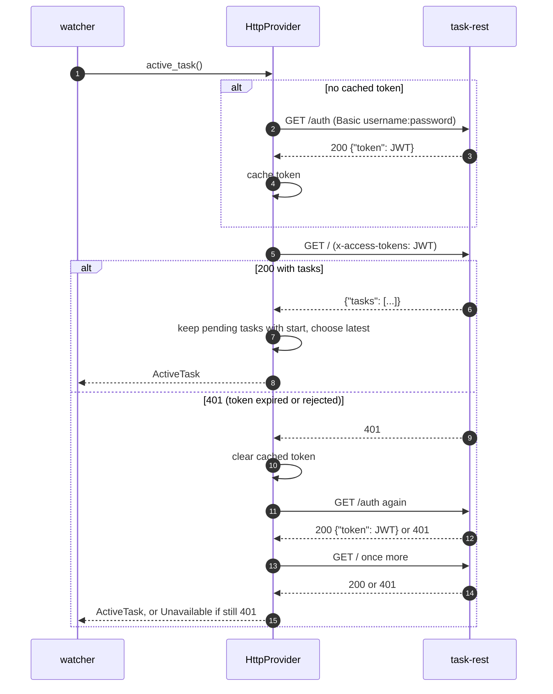

# REQ-007: HTTP REST task provider (task-rest)

- **Status:** Implemented
- **Added:** 2026-11-05 (contract verified against a live task-rest instance, 2026-11-06)
- **Owner:** maintainer

## Rationale

The `task-rest` service (`~/workspace/task-rest`, Flask + tasklib around TaskWarrior) exposes the user's tasks over HTTP. A second provider lets the watcher read the active task from that service, through the same `TaskProvider` seam as the CLI provider (REQ-006). The watcher's poll loop does not change.

## Design

### Crate and wiring

- New crate `crates/aw-taskwarrior-provider-http`, implementing `TaskProvider` (REQ-006).
- `NAME = "http"`; `create(settings)` as in the CLI provider.
- Watcher: feature `provider-http`, on by default, plus one `cfg` arm in `providers.rs`. The default provider stays `cli`.
- HTTP client: `reqwest` 0.11 in blocking mode, with `json` and `rustls-tls-native-roots`. These are the version and features `aw-client-rust` already uses, so no new crate is compiled in.

### Settings

Stored in the existing daemon config (REQ-009), under the provider's table:

```toml
[aw-taskwarrior]
provider = "http"

[aw-taskwarrior.providers.http]
base_url = "http://127.0.0.1:5000"   # required; http or https; no user info; a path prefix is allowed
username = "dev"                      # required
password = "password"                 # required; never logged
timeout_seconds = 5                   # optional, positive integer, default 5
```

- Missing or invalid values fail at startup with `InvalidConfig` naming the key. `create` does no network I/O.
- The password is stored in plain text in the same file as the ActivityWatch `api_key`. The file should be readable only by its owner. This is a deliberate choice.

### API contract (task-rest, verified)

| Step | Request | Success | Failure seen on the live API |
|------|---------|---------|------------------------------|
| Authenticate | `GET /auth`, HTTP Basic (`username`, `password`) | `200`, body `{"token": "<JWT>"}` | Wrong password: `401`, plain-text body `Could not verify`, header `WWW.Authentification` |
| List tasks | `GET /` with header `x-access-tokens: <JWT>` | `200`, body `{"tasks": [...]}` | No token, bad token or expired token: `401`, plain-text `Could not verify` |

- The token lifetime is set per user on the server (`TOKEN_EXP`, minutes). The dev user has 999 minutes, and the `exp` claim is in the token.
- `GET /` has no filter parameters. It returns **every** task, including completed and deleted ones. Measured on the development data: 581 tasks, about 1.6 MB (see [REQ-010](REQ-010-task-rest-attribute-filter.md)).
- Each `GET /` runs a full `task export` on the server.

Captured task object (a pending task with a start date; field values from the test data):

```json
{
  "description": "A pending started",
  "entry": "Thu, 05 Nov 2026 23:27:01 -0600",
  "id": 1,
  "modified": "Thu, 05 Nov 2026 23:27:01 -0600",
  "start": "Thu, 05 Nov 2026 23:27:01 -0600",
  "status": "pending",
  "urgency": 4.0,
  "uuid": "1270e71e-3013-4514-8653-98d78057c138"
}
```

Observed rules for task objects:
- Dates use RFC 2822 text with a numeric offset (`-0600` on the test server). Parse with `chrono::DateTime::parse_from_rfc2822`.
- `None` values and empty lists are **omitted**. A task with no start date has no `start` key. A task with no project has no `project` key. A task with no tags has no `tags` key.
- `status` is `pending`, `completed` or `deleted`. Completed and deleted tasks are returned too.
- Completing a task removes its `start`, so a completed task never has a `start` key.

Errors:
- Bad input to `POST /` returns `400` with `{"message": {"description": "...", "type": "error"}}`.
- An unknown uuid returns `404` with the same `message` shape.
- A TaskWarrior error on a read is returned in the `message` shape too. The provider must handle any non-2xx response that carries a `message` object, and a `200` that has no `tasks` key and a `message` of type `error`.

### Mapping to the active task

Active means `status == "pending"` and a `start` value, the same meaning as TaskWarrior's `+ACTIVE`. From the list:

1. Keep only active tasks.
2. Choose the one with the latest `start`. Ties are broken by the higher `id`. An unparseable `start` sorts last.
3. Map to `ActiveTask`: `uuid`, `title` = `description`, `project` = the `project` value or `"No project"`, `tags` = the `tags` value or an empty list.
4. No active task: `ActiveTask::default_task()`.

The client-side filter is the only filter until REQ-010 exists. Its cost is that every poll downloads the full list.

### Authentication flow



### Error mapping

| Condition | Result |
|-----------|--------|
| Timeout (`timeout_seconds`) | `ProviderError::Timeout` |
| Connection refused, DNS, TLS, other transport error | `Unavailable(...)` |
| `401` after one re-authentication | `Unavailable("authentication rejected: check username and password")` |
| Non-2xx with a `message` object, or `200` with `message.type == "error"` and no `tasks` | `Unavailable(message.description)` |
| Body is not JSON, or `tasks` is not a list | `InvalidResponse(...)` |

- Secrets (`password`, token) never appear in logs or in error text. Errors include only the status code and the server's `message`.
- Credentials are never placed in the URL.

### Limits

- TLS uses the system trust store only. Self-signed HTTPS certificates are not supported.
- The client-side filter downloads the whole list on every poll. REQ-010 removes this cost.

## Acceptance criteria

- [x] With `provider = "http"` and the feature enabled, the watcher reads the active task from task-rest. Verified against the live API: the live test returned the expected task (`F work with tags`).
- [x] The selection rule matches `task +ACTIVE` on the same data: pending, with a start, latest start first. Verified: the API's pending-with-start set equals TaskWarrior's `+ACTIVE` set (`A`, `E`, `F`).
- [x] A token rejected with `401` is replaced once, and the request is retried. Covered by a mock-server test; the real server returns `401` for an expired token (checked with a forged token).
- [x] Unreachable service: the last known task is reused and the error is logged (the same `resolve_task` policy as the CLI provider).
- [x] Wrong password: `Unavailable`, with the message `authentication rejected`. The password is not in the error (test).
- [x] Missing or invalid `[aw-taskwarrior.providers.http]` settings fail at startup with `InvalidConfig` naming the key. Verified at runtime: a missing `password` and a `base_url` with user info both stopped the daemon with the key named.
- [x] `base_url` containing user info is rejected at startup (test and runtime).
- [x] The tests run against the captured responses (`tests/fixtures/task_list.json`, from the live API) and against a loopback mock. No other network access.

## Code references

- Implemented in: `crates/aw-taskwarrior-provider-http/src/lib.rs` (`create`, `HttpProvider`, `select_active`, `read_active_task`), `crates/aw-taskwarrior/src/providers.rs` (`http` arm), `crates/aw-taskwarrior/Cargo.toml` (feature `provider-http`), `tests/fixtures/task_list.json`.
- Verified against task-rest at `~/workspace/task-rest` (Flask, pinned dependencies from `Pipfile.lock`, TaskWarrior 3.5.0), in a scratch copy. The task-rest repository was not modified.
