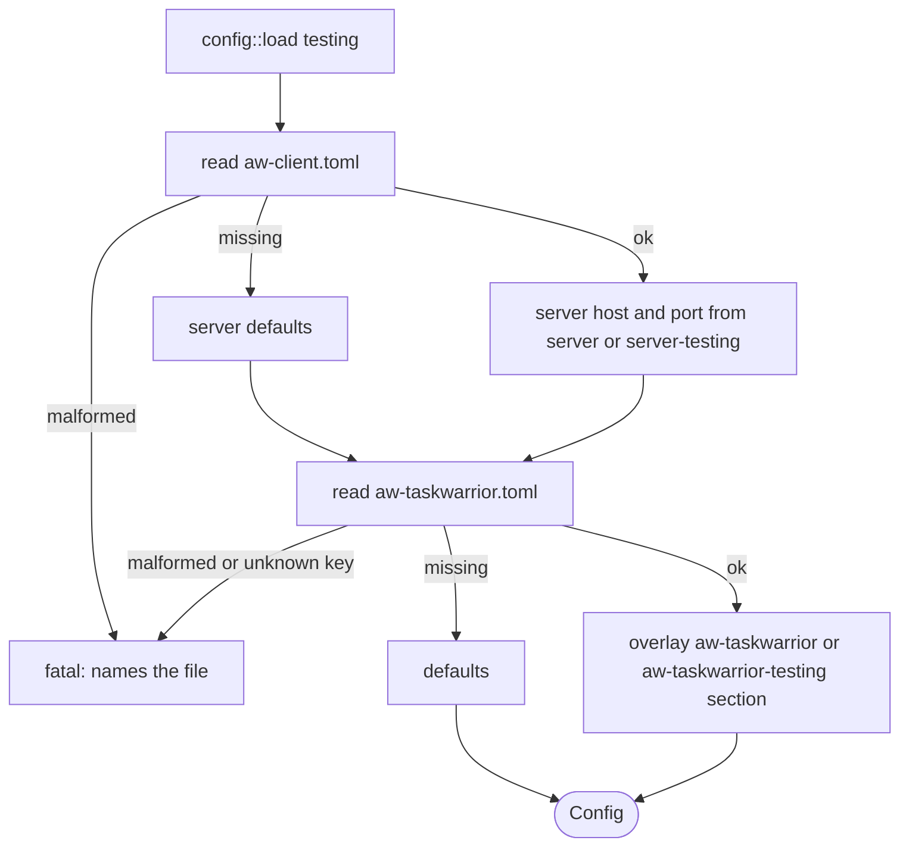

# REQ-009: Follow the ActivityWatch config convention; server settings from aw-client.toml

- **Status:** Documented, not implemented
- **Added:** 2026-11-05
- **Owner:** maintainer

## Rationale

ActivityWatch components keep their config in `~/.config/activitywatch/<component>/<component>.toml`, with one section per component and a `-testing` variant. The server address lives once, in `aw-client.toml`. aw-taskwarrior used its own path (`~/.config/aw-taskwarrior/config.toml`), a flat layout, and its own server host and port keys. That gives two places to set the server and a layout unlike every other component.

## Design

### Files

| File | Path | Role |
|------|------|------|
| Client config | `~/.config/activitywatch/aw-client/aw-client.toml` | Single source of truth for the server host and port. Read-only for this daemon. |
| Component config | `~/.config/activitywatch/aw-taskwarrior/aw-taskwarrior.toml` | Settings of this daemon |

The base directory is `dirs::config_dir()` (honors `XDG_CONFIG_HOME`). Both files are optional; a missing file means defaults. The old path `~/.config/aw-taskwarrior/config.toml` is **not read** (no fallback). A leftover file there is ignored.

### Server settings (from `aw-client.toml`)

```toml
[server]
hostname = "127.0.0.1"
port = "5600"            # ActivityWatch writes the port as a string; an integer is also accepted

[server-testing]
hostname = "127.0.0.1"
port = "5666"
```

- Only `[server]` (or `[server-testing]` in testing mode) is read. Other sections (`[client]`, `[client-testing]`) are ignored.
- Defaults when a key or the file is missing: host `127.0.0.1`, port `5600` (testing: `5666`). These match ActivityWatch. The previous default host was `localhost`.
- `aw_server_host` and `aw_server_port` are no longer settings of this daemon.

### Daemon settings (from `aw-taskwarrior.toml`)

```toml
[aw-taskwarrior]
provider = "cli"
poll_interval_seconds = 5
offline_tag = "OFFLINE"
online_pulsetime_seconds = 120
offline_pulsetime_seconds = 43200
api_key = "..."

[aw-taskwarrior.providers.cli]     # provider settings, see REQ-006
timeout_seconds = 5

[aw-taskwarrior-testing]           # used instead of [aw-taskwarrior] in testing mode
poll_interval_seconds = 1
```

- `api_key` stays here, because `aw-client.toml` has no such key.
- The `[aw-taskwarrior]` section rejects unknown keys. A leftover `aw_server_host` or `aw_server_port` is a fatal startup error that names the key, so a removed setting never fails silently. Other sections in the file are ignored.
- Testing mode reads `[aw-taskwarrior-testing]` and `[server-testing]` instead of the normal sections. The mode is selected by `config::load(testing: bool)`; it is always `false` until REQ-001 adds the `--testing` flag.

### Errors

- A missing file is not an error.
- An unreadable or malformed file is fatal at startup. The message names the file path. This applies to `aw-client.toml` too.



## Acceptance criteria

- [ ] Server host and port come from `aw-client.toml` `[server]`; a string or integer port both work.
- [ ] Without `aw-client.toml`, the server is `127.0.0.1:5600`.
- [ ] Settings are read from `[aw-taskwarrior]` in `~/.config/activitywatch/aw-taskwarrior/aw-taskwarrior.toml`, including `[aw-taskwarrior.providers.<name>]`.
- [ ] The old path `~/.config/aw-taskwarrior/config.toml` is never read.
- [ ] A leftover `aw_server_host` or `aw_server_port` in `[aw-taskwarrior]` fails at startup and names the key.
- [ ] A malformed file fails at startup and names the file path.
- [ ] `config::load(true)` reads the `-testing` sections and defaults to port `5666`.

## Code references

- Implemented in: (none yet)
