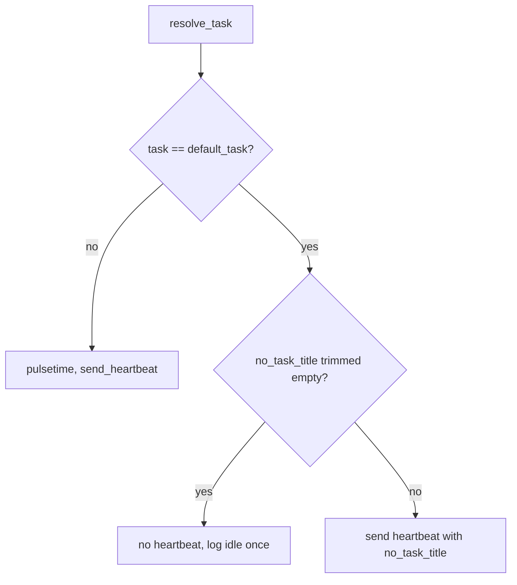

# REQ-015: Configurable title for idle periods, empty by default

- **Status:** Documented, not implemented
- **Added:** 2026-11-09
- **Owner:** maintainer

## Rationale

When no TaskWarrior task is active, the daemon sends a heartbeat titled `No task tracked`. That fills every idle period with an event that carries no information, and the title cannot be changed. The owner wants idle time to show as a gap by default. A title can still be set for users who want the marker.

## Design

### Config key

A new key `no_task_title` in `[aw-taskwarrior]` (`aw-taskwarrior.toml`):

| Value | Effect while no task is active |
|-------|--------------------------------|
| Unset (default) | No heartbeat is sent. The idle period is a gap. |
| `""` (empty string) | Same as unset. |
| Whitespace only | Same as unset (the value is trimmed before the check). |
| Any other text | A heartbeat is sent with that text as its title and no project or tags. |

TOML has no null, so "unset" and the empty string are the two ways to ask for no title.

The key is read from the daemon's own file only. The testing section `[aw-taskwarrior-testing]` accepts it too, like the other keys.

### Where the decision is made

- The providers keep returning `ActiveTask::default_task()` when no task is active. Its title becomes the empty string. The providers do not read config (REQ-006).
- The watcher decides what to do with the idle task. `activitywatch::heartbeat_task(&ActiveTask, &Config) -> Option<ActiveTask>` returns `None` when the task equals `default_task()` and `no_task_title` is empty after trimming. It returns the task with its title replaced when `no_task_title` is set, and the task unchanged otherwise.
- The poll loop in `main.rs` skips `send_heartbeat` on `None`. It still sleeps for the poll interval. It logs one info line when the daemon goes idle, and no line on each idle poll.

See [../modules.md](../modules.md) for the changed items.

### Dependencies

None added. `aw-taskwarrior-core` keeps zero dependencies.

## Acceptance criteria

- [ ] With no `no_task_title` in the config file, or with no config file, no heartbeat is sent while no task is active.
- [ ] With `no_task_title = ""` or whitespace only, the same as the default.
- [ ] With `no_task_title = "Idle"`, idle polls send a heartbeat titled `Idle` with no project and no tags.
- [ ] A real active task is sent exactly as before, whatever `no_task_title` is.
- [ ] The idle log line is written once per transition to idle, not on every poll.
- [ ] The generated default config file keeps the key commented out (test).

## Code references

- Implemented in: (empty until implemented) `crates/aw-taskwarrior-core/src/lib.rs` (`default_task`), `crates/aw-taskwarrior/src/config.rs` (`no_task_title`), `crates/aw-taskwarrior/src/activitywatch.rs` (`heartbeat_task`), `crates/aw-taskwarrior/src/main.rs` (poll loop); `examples/aw-taskwarrior.toml`.
